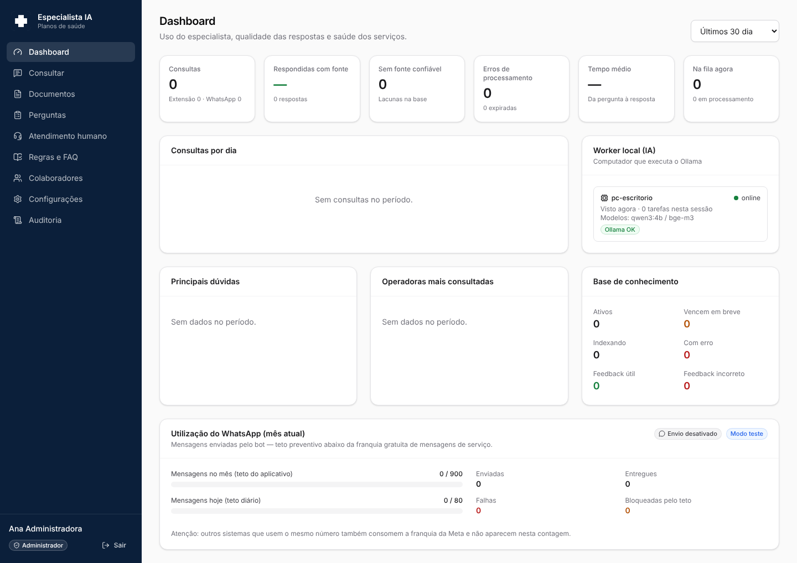
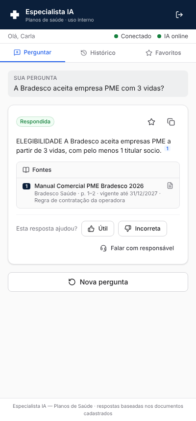

# Especialista IA — Planos de Saúde

Especialista virtual em planos de saúde para a equipe interna da corretora (assessores, vendedores,
comerciais e operadores). Responde **somente com base nos documentos cadastrados e vigentes**, sempre
com fonte, e diz claramente quando não há regra confirmada:

> Não encontrei uma regra atualizada e confirmada na nossa base de conhecimento. Recomendo validar com o responsável pela operadora antes de orientar o cliente.

Dois canais, um único motor (`answerQuestion()`), uma única base de conhecimento e um único painel:

1. **Extensão do Google Chrome** (Manifest V3, painel lateral `chrome.sidePanel` ao lado do WhatsApp Web — sem ler conversas).
2. **Bot no WhatsApp oficial** (WhatsApp Business Cloud API da Meta, webhook assinado, teto de consumo).

Prioridade absoluta: **custo zero de operação** — IA local (Ollama), Supabase Free, Netlify Free, nenhuma API paga.

| Painel | Extensão |
|---|---|
|  |  |

> As imagens foram capturadas pelos testes automatizados de interface (navegador real), com a IA simulada.

---

## Arquitetura (resumo)

```
 Colaborador ── Extensão Chrome (side panel) ──┐                 ┌── Painel admin (Netlify, React)
                                               ▼                 ▼
 Colaborador ── WhatsApp ── Meta Cloud API ──► Supabase (Free): PostgreSQL + pgvector + Auth + Storage
                               │  webhook       │   RLS em todas as tabelas · fila processing_jobs
                               ▼                │   Edge Functions: especialista-whatsapp-webhook / -whatsapp-send / -admin-users
                       Edge Function            │
                       (assinatura, fila)       ▼ (HTTPS de saída; nenhuma porta aberta no escritório)
                                         Worker local (Node) ── Ollama em 127.0.0.1:11434
                                         · answerQuestion() (RAG híbrido)   · qwen3:4b / llama3.2:3b
                                         · indexação PDF/DOCX/XLSX/CSV/TXT  · bge-m3 (embeddings)
```

- O **Ollama nunca é exposto**: o worker roda no mesmo computador e **busca** tarefas no Supabase (Realtime + consulta periódica).
- O worker usa uma **conta de máquina** (papel `worker`) com privilégio mínimo — nada de service role no computador.
- Se o computador estiver desligado, as perguntas ficam **pendentes**; ao religar, a fila é retomada (bloqueios vencidos são recuperados).
- Detalhes: [docs/ARQUITETURA.md](docs/ARQUITETURA.md).

## Estrutura

```
especialista-ia/
├── apps/
│   ├── admin/              Painel (Vite + React + Tailwind) — Netlify
│   ├── chrome-extension/   Extensão MV3 (side panel)
│   └── local-worker/       Worker Node: fila, Ollama, indexação, OCR opcional, diagnóstico
├── packages/
│   ├── ai-core/            answerQuestion(), RAG, priorização de fontes, validação, provedores de IA
│   ├── shared/             Domínio: LGPD/PII, entidades, temas, telefones, prompt injection, formatos
│   └── ui/                 Design system e componentes compartilhados (extensão + painel)
├── supabase/
│   ├── migrations/         Esquema, RLS, RPCs, busca híbrida, fila, WhatsApp, auditoria, retenção
│   ├── functions/          Edge Functions (Deno) + regras em TypeScript puro (_shared)
│   ├── config.toml · seed.sql (dados FICTÍCIOS só para desenvolvimento)
├── scripts/                Windows (instalar/iniciar/início automático), SQL utilitários, sync das functions
├── tests/                  unit · db (PostgreSQL real) · stack (navegador + Auth/PostgREST oficiais)
└── docs/                   Guias de implantação, Ollama, extensão, WhatsApp, base de conhecimento, custos
```

Este diretório é **independente** do sistema que já existe na raiz do repositório (BeSmart Health Cockpit):
toolchain, dependências e testes próprios. A única mudança fora daqui foi excluir `especialista-ia/` do
`tsconfig.json`/ESLint da raiz e adicionar um workflow de CI próprio.

## Início rápido

Pré-requisitos: Node.js 20+ (testado com 22), conta gratuita no Supabase, conta gratuita na Netlify,
um computador com 8 GB+ de RAM para o Ollama.

```bash
cd especialista-ia
npm ci
```

1. **Supabase** — crie o projeto e aplique as migrations (`supabase link` + `supabase db push`, ou cole os arquivos de `supabase/migrations` em ordem no SQL Editor). Crie seu usuário em *Authentication → Users* e execute `scripts/sql/primeiro-admin.sql`. Passo a passo: [docs/IMPLANTACAO.md](docs/IMPLANTACAO.md).
2. **Edge Functions** — `supabase functions deploy especialista-admin-users especialista-whatsapp-send` (+ `especialista-whatsapp-webhook --no-verify-jwt`) (o webhook só é necessário para o WhatsApp).
3. **Painel** — copie `.env.example` para `.env`, preencha `VITE_SUPABASE_URL` e `VITE_SUPABASE_ANON_KEY`; publique na Netlify (`netlify.toml` incluso) ou rode `npm run dev:admin`.
4. **Worker + Ollama** — no Windows: `scripts\windows\instalar-worker.ps1`. Guia: [docs/GUIA_OLLAMA_WINDOWS.md](docs/GUIA_OLLAMA_WINDOWS.md).
5. **Extensão** — `npm run build:extension` e carregue `apps/chrome-extension/dist` em `chrome://extensions`. Guia: [docs/GUIA_EXTENSAO.md](docs/GUIA_EXTENSAO.md).
6. **Base de conhecimento** — cadastre os documentos oficiais das operadoras: [docs/MANUAL_BASE_CONHECIMENTO.md](docs/MANUAL_BASE_CONHECIMENTO.md).
7. **WhatsApp (opcional)** — [docs/GUIA_WHATSAPP.md](docs/GUIA_WHATSAPP.md). Começa **desativado**.

## Scripts

| Comando | O que faz |
|---|---|
| `npm run dev:admin` | Painel em modo desenvolvimento (http://localhost:5173) |
| `npm run build` | Build do painel, da extensão e checagem de tipos do worker |
| `npm run worker` / `npm run worker:doctor` | Inicia o worker / diagnóstico de hardware, Ollama, modelos e OCR |
| `npm -w @especialista/chrome-extension run package` | Gera o `.zip` da extensão (com verificação de segredos) |
| `npx tsc -b` | Verificação de tipos de todo o monorepo |
| `npm run test:unit` | Testes unitários (motor, LGPD, WhatsApp, Graph API) |
| `npm run test:db` | Banco real: migrations, RLS, fila, busca híbrida, teto do WhatsApp, worker e bot ponta a ponta |
| `npx vitest run --project stack` | Interface no navegador real (requer Docker; ver [docs/TESTES.md](docs/TESTES.md)) |
| `node scripts/sync-edge-shared.mjs` | Copia `packages/shared` para as Edge Functions (rode após alterar o shared) |

## Variáveis de ambiente

- `especialista-ia/.env` (painel/extensão): somente valores **públicos** — `VITE_SUPABASE_URL`, `VITE_SUPABASE_ANON_KEY`.
- `apps/local-worker/.env`: conexão do worker (conta de máquina) e Ollama local — veja `apps/local-worker/.env.example`.
- Segredos da Meta: **apenas** em *Edge Functions → Secrets* no Supabase.

## O que foi testado (e como)

- **Unitários (46)**: extração de entidades, minimização de dados (CPF, CNPJ, telefone, e-mail, CNS, nomes),
  prompt injection, chunking, qualidade de extração, validação de citações e de números, cenários do
  `answerQuestion()` (com fonte, sem fonte, vencido, conflito, informação faltante, regional, condição
  negociada, FAQ direta, injeção, diagnóstico médico, Ollama fora do ar), assinatura `X-Hub-Signature-256`
  (conferida contra o `openssl`), verificação do webhook, cliente da Graph API com retentativas/Retry-After.
- **Banco real (PostgreSQL 16 + pgvector, 64 testes incluindo os ponta a ponta abaixo)**: todas as migrations; RLS por papel; escalonamento de privilégio;
  fila com `SKIP LOCKED` sob concorrência; recuperação de bloqueio vencido; janela de 24 h; versões de
  documento; busca híbrida; teto do WhatsApp sob 12 envios simultâneos; idempotência; auditoria; retenção.
- **Ponta a ponta do worker**: upload → extração → embeddings → pergunta → resposta com página da fonte,
  usando o cliente HTTP real do Ollama contra um servidor que imita a API oficial.
- **Ponta a ponta do WhatsApp**: webhook assinado → fila → worker → envio pela Graph API simulada → status de entrega.
- **Interface (9 cenários)**: Chromium real com o painel e a extensão carregada, Auth (GoTrue) e PostgREST **oficiais do Supabase** em Docker.

**Não testado com serviços reais** (bloqueados neste ambiente ou dependentes das suas credenciais): modelos
reais do Ollama, a Graph API da Meta, a Chrome Web Store e um projeto Supabase/Netlify em nuvem.
O que falta para ativar cada um está em [docs/IMPLANTACAO.md](docs/IMPLANTACAO.md#o-que-falta-configurar).

## Segurança e LGPD (resumo)

RLS em todas as tabelas; cadastro público desligado; papéis Administrador/Editor/Colaborador + conta de
máquina; segredos só no servidor; dados pessoais removidos no navegador **e** no banco antes de chegar ao
modelo; logs sem conteúdo; retenção configurável; auditoria automática; nenhum dado enviado a terceiros
para treinamento (o modelo roda localmente). Detalhes: [docs/SEGURANCA_LGPD.md](docs/SEGURANCA_LGPD.md).

## Custos

Tudo dentro de planos gratuitos, com teto preventivo de **900 mensagens/mês** no WhatsApp. Leia
[docs/CUSTOS_E_LIMITES.md](docs/CUSTOS_E_LIMITES.md) — a Meta mudou a cobrança das mensagens de serviço
em outubro de 2026, e a tabela oficial precisa ser conferida antes de ativar em produção.
